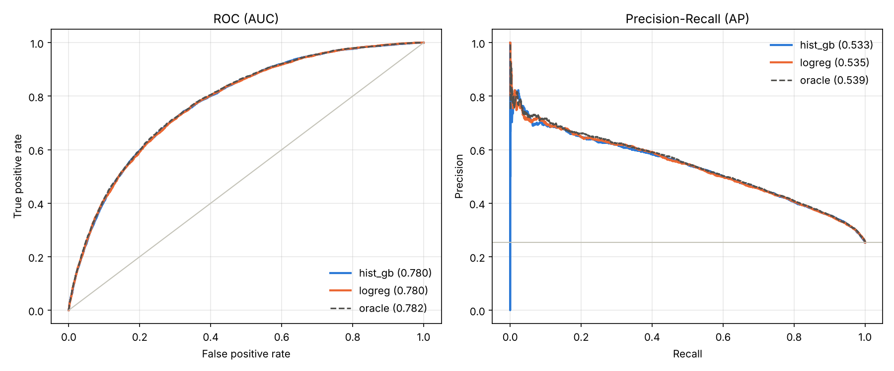

# Churn prediction: how close do models get to the best possible score?

Customer churn classifier on synthetic telecom data, built as an evaluation exercise:
a logistic-regression baseline, gradient boosting, leak-free feature engineering inside
sklearn pipelines, cross-validation, and a comparison against the **Bayes-optimal ceiling**.
Because the data is synthetic, the true churn probability of every customer is known, so
we can measure not only which model is better but how much room for improvement is left.

## TL;DR

- On 20 000 held-out customers both the **baseline and boosting reach ROC-AUC 0.780**;
  the true probabilities score **0.782**. The models are within 0.003 AUC of the ceiling, so a
  heavier model or hyperparameter search cannot add anything meaningful on this data.
- **Features matter more than the model.** Removing the engineered features costs
  logistic regression **0.017 AUC** and boosting **0.011 AUC**, better on 5/5 folds for both.
  The model choice changes AUC by 0.0006, well inside one standard deviation.
- Targeting the **top 10 %** of customers by predicted risk finds churners with
  **63.5 %** precision vs. a 25.3 % base rate (2.5× lift).
- The first version of this project reported **ROC-AUC 0.996**. That number was a bug in the
  data, not a good model; see [What changed](#what-changed-and-why).



## Data

100 000 synthetic customers: tenure, monthly and total charges, number of services,
internet/phone flags, payment method, contract type and age (`src/data_processing.py`).

Churn is **sampled**, not assigned by a rule: each customer leaves with probability
`p = sigmoid(logit)`, where the logit grows with short tenure, high price, month-to-month
contract, few services, a recent price increase, paying by check and age under 30.
Base churn rate is 25.3 %. The true `p` is stored separately, never used as a feature
(a test checks this), and gives the *oracle* row in the results.

## Method

| Step | Choice | Why |
|---|---|---|
| Split | Stratified 80/20, test set touched once at the end | Model selection on test would make the final score optimistic |
| Features | `ChurnFeatures` sklearn transformer: price-increase ratio, age groups, high-charge/long-tenure flags, interactions | Thresholds (75th percentiles) are learned in `fit` on train only and reused on test and in production |
| Preprocessing | Scaling for logistic regression only, one-hot for categories, binary flags as is | Trees are scale-invariant; a nominal feature must not get a fake order |
| Baseline | Logistic regression | Boosting has to beat it to justify its complexity |
| Boosting | sklearn HistGradientBoosting, LightGBM, XGBoost, CatBoost (native categoricals), same budget of 300 trees, lr 0.05 | Fair comparison; boosting libraries are optional |
| Validation | 5-fold stratified CV on train, same folds for every model | Mean ± std, and paired comparisons between models |
| Metrics | ROC-AUC, PR-AUC, Brier score, precision in the top 10 % | Ranking quality, quality on the minority class, calibration, business value |

## Results

Cross-validation on train (5 folds):

| Model | ROC-AUC | PR-AUC |
|---|---|---|
| Logistic regression | 0.7776 ± 0.0037 | 0.539 ± 0.007 |
| HistGradientBoosting | 0.7770 ± 0.0032 | 0.537 ± 0.006 |

Held-out test (20 000 customers):

| Model | ROC-AUC | PR-AUC | Brier ↓ | Precision @ top 10 % |
|---|---|---|---|---|
| Oracle (true probabilities) | 0.782 | 0.539 | 0.152 | 0.642 |
| Logistic regression | 0.780 | 0.535 | 0.153 | 0.635 |
| HistGradientBoosting | 0.780 | 0.533 | 0.153 | 0.628 |

Feature ablation (`experiments/feature_ablation.py`), ROC-AUC on the same 5 folds:

| Model | Raw features | + engineered | Gain (paired) | Folds improved |
|---|---|---|---|---|
| Logistic regression | 0.7610 | 0.7776 | +0.0166 ± 0.0018 | 5/5 |
| HistGradientBoosting | 0.7663 | 0.7770 | +0.0107 ± 0.0009 | 5/5 |

**Reading the results**

- Logistic regression ties with boosting because the churn logit in the generator is
  additive, so a linear model is correctly specified. On real data with interactions the
  gap is usually larger, which is exactly what the baseline is there to measure.
- Without the price-increase ratio a linear model cannot express "the price went up"
  (it is a ratio of two raw columns), and it loses most. Trees approximate the ratio with
  splits and lose less. The generator includes this effect by design, so the ablation checks
  that the pipeline can exploit such structure; it is not a finding about real customers.
- The paired gain has a 2–4× smaller spread than the scores themselves: most of the
  fold-to-fold variance is shared by all models, so comparisons are made fold by fold.

The tables were produced with logistic regression and sklearn's HistGradientBoosting.
`python main.py` with all requirements installed adds CatBoost, LightGBM and XGBoost to
`reports/` and a SHAP summary for the best boosting model.

## What changed and why

The first version (in git history) had several issues that are now fixed and covered by tests:

| Issue | Effect | Fix |
|---|---|---|
| Churn assigned by the rule `score > 0.5` | Target was a deterministic function of features: ROC-AUC 0.996 | Churn sampled from `p = sigmoid(logit)`; oracle AUC reported as the ceiling |
| `total_charges` independent of tenure | Unrealistic data (correlation 0.00) | `total ≈ tenure × monthly × past-price factor` (correlation 0.74) |
| Quantile thresholds recomputed on each dataset | Test statistics leaked into test features; meaningless for a single customer | Thresholds learned in `ChurnFeatures.fit` on train |
| `is_middle_age = age & (age <= 60)` | Bitwise AND: the flag meant "odd age up to 60" | `(age >= 30) & (age <= 60)` |
| Payment method encoded as 0–3 and scaled | Fake order between categories, duplicate of one-hot | Removed |
| CatBoost trained on one-hot data, `early_stopping_rounds` without a validation set | Lost native categorical handling; a no-op parameter | Native `cat_features`; parameter removed |
| No baseline, single train/test score | No way to tell whether boosting helps or how noisy the score is | Logistic regression baseline, 5-fold CV |

## Quickstart

```bash
python -m venv .venv && source .venv/bin/activate   # Windows: .venv\Scripts\activate
pip install -r requirements-dev.txt

python main.py                                      # generate -> CV + train -> evaluate
python main.py --models logreg hist_gb --n-samples 20000 --folds 3   # quick run
python experiments/feature_ablation.py
pytest                                              # invariants: no leakage, learned thresholds, ...
```

## Project structure

```
main.py                     # CLI: --generate / --train / --evaluate
config.py                   # paths, columns, hyperparameters
src/
├── data_processing.py      # synthetic data with a known churn probability, train/test split
├── feature_engineering.py  # ChurnFeatures transformer (fit on train, transform anywhere)
├── models.py               # all models as pipelines: features -> preprocessing -> classifier
├── train.py                # cross-validation, fit on full train, save models
└── evaluate.py             # test metrics vs. the oracle, ROC/PR curves, SHAP
experiments/                # feature ablation
tests/                      # leakage and correctness checks
reports/                    # committed metrics and figures
```

## Next steps

- [ ] Real data: the same pipeline on the public Telco Customer Churn dataset (no oracle there)
- [ ] Interactions in the generator (e.g. price sensitivity depending on contract type): when does boosting start to beat the linear baseline?
- [ ] Threshold selection from a cost matrix (cost of a retention offer vs. a lost customer)
- [ ] Calibration curves
